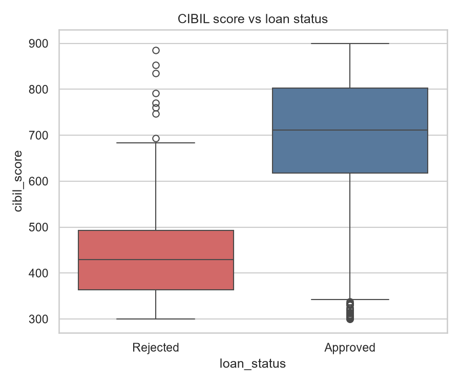
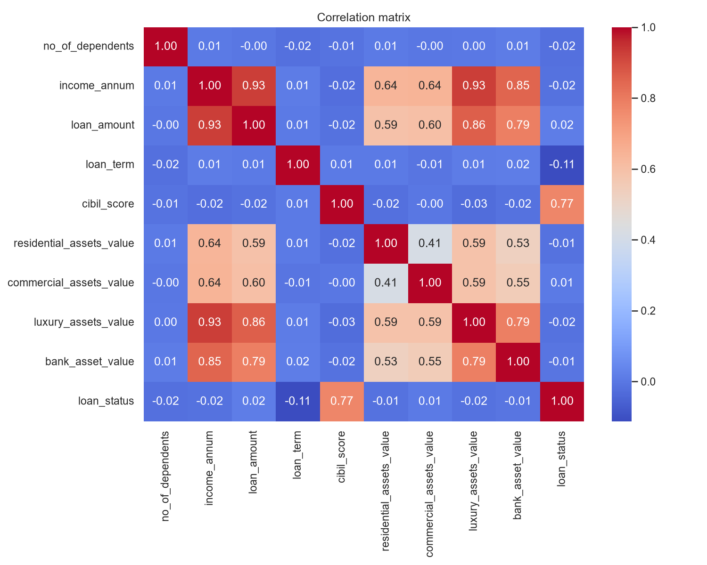
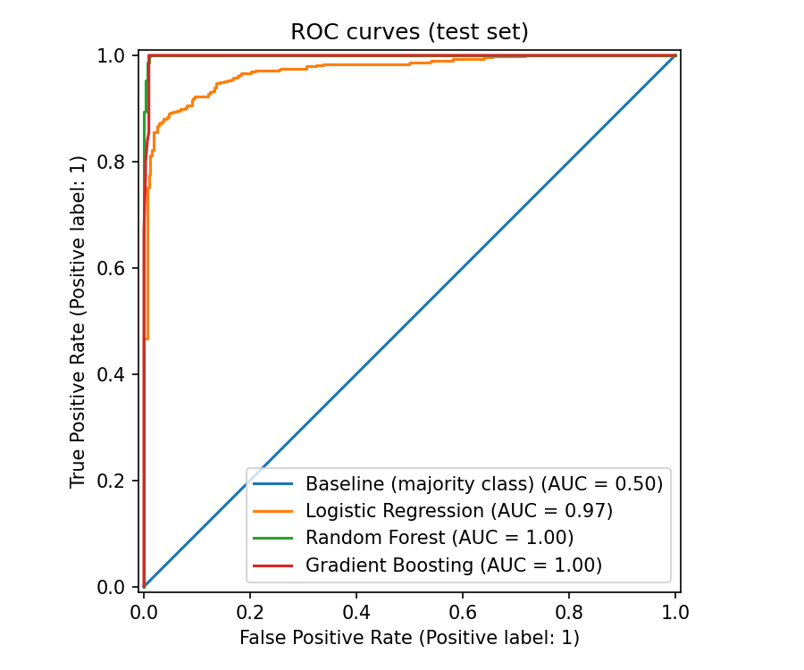
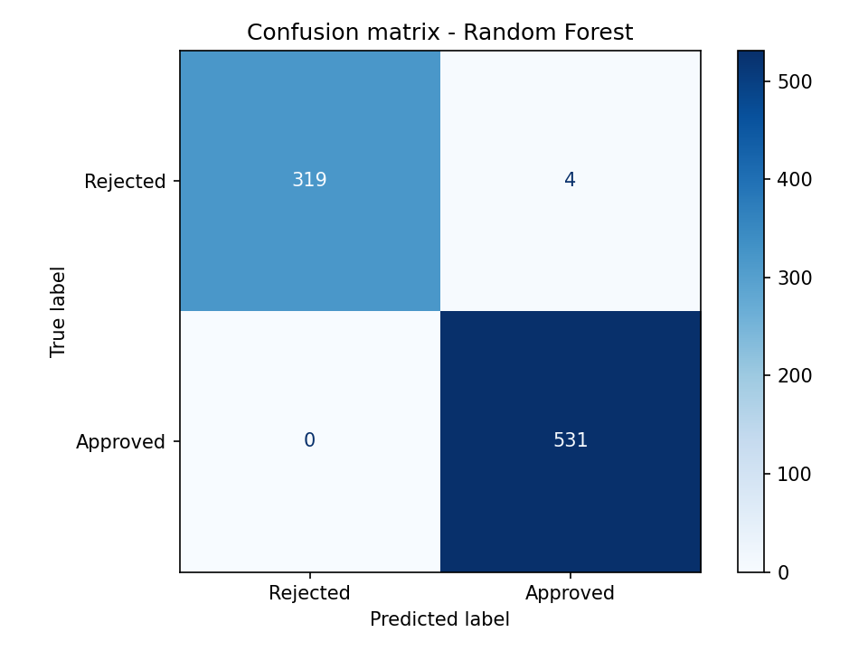
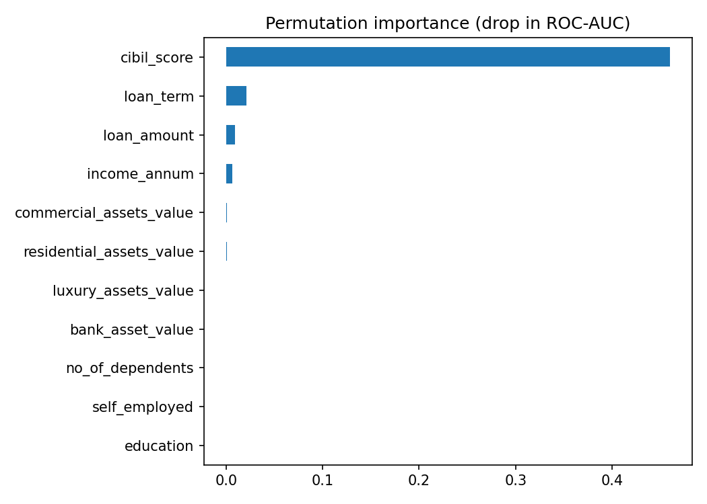

Create README.md and paste:

markdown
# Loan Approval Prediction

Predicts whether a loan application should be approved based on applicant
details and financial information, using machine learning, with a Streamlit
app for live predictions.

## Problem Statement
Banks must decide quickly and consistently whether to approve a loan. This
project builds and compares ML classifiers that predict approval
(Approved / Rejected) from applicant and financial features.

## Objectives
1. Explore the data and test which factors are associated with approval
   (chi-square, Mann-Whitney U, Welch t-test, confidence intervals).
2. Build a baseline and three tuned ML models with leak-free preprocessing
   and cross-validation.
3. Compare models using precision, recall, F1, ROC-AUC and confusion matrix.
4. Deploy the best model as a Streamlit web app.

## Dataset
Loan Approval Prediction Dataset (Kaggle, uploaded by Archit Sharma).
4,269 applications, 12 features + target (`loan_status`).
File: `data/loan_approval_dataset.csv`

## Project Structure
```
data/        dataset
outputs/     figures and result tables
models/      saved trained model
```

## Setup
```
python -m venv venv
venv\Scripts\activate
pip install -r requirements.txt
```

## Results

## Exploratory Data Analysis
- No missing values or duplicate rows. Approval rate is ~62% (95% CI ~60.8-63.7%),
  so classes are mildly imbalanced and accuracy alone would be misleading.
- CIBIL score is by far the strongest separator: approved applicants have a much
  higher median score (Welch t-test p < 0.001).
- Chi-square tests show no significant association between approval and
  education or self-employment status (p > 0.05).
- Mann-Whitney U tests (non-parametric, since the features are not normally
  distributed) compare each numeric feature between approved and rejected loans.




Held-out test set (20%, stratified). Models tuned with 5-fold CV on the training set;
final model chosen by cross-validated F1, not test score.

| Model | CV F1 | Precision | Recall | F1 | ROC-AUC |
|---|---|---|---|---|---|
| Baseline (majority class) | n/a | 0.622 | 1.000 | 0.767 | 0.500 |
| Logistic Regression | 0.931 | 0.920 | 0.932 | 0.926 | 0.972 |
| Random Forest | 0.997 | 0.993 | 1.000 | 0.996 | 0.9995 |
| Gradient Boosting | 0.997 | 0.993 | 1.000 | 0.996 | 0.998 |

Random Forest and Gradient Boosting are statistically equivalent on CV F1.




**Interpretation:** CIBIL score dominates the permutation importance. Random Forest
and Gradient Boosting are not significantly different (paired t-test on 5-fold
CV ROC-AUC), so Random Forest was kept as the final model.
## Limitations
To be added.